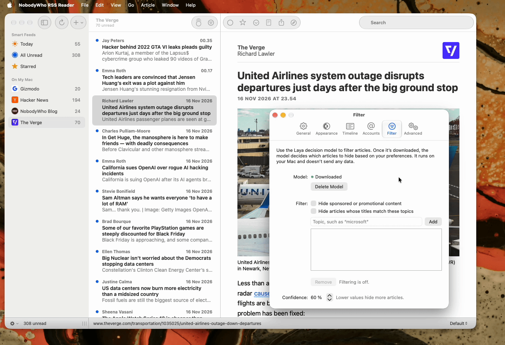

# NobodyWho RSS Reader

This is a fork of [NetNewsWire](https://netnewswire.com/), a free and open-source feed reader for macOS and iOS.

The macOS app has been modified and has an extra filtering feature, using Laya decision model with [NobodyWho](https://github.com/nobodywho-ooo/nobodywho) inference engine. Once you have downloaded the model, you can filter the news, either by removing ads or hide certain topics, or both.

# Download the app

Go to the [release section](https://github.com/nobodywho-ooo/NobodyWho-RSS-Reader/releases) or download the v1.0.0 version [here](https://github.com/nobodywho-ooo/NobodyWho-RSS-Reader/releases/download/v1.0.0/NobodyWho.RSS.Reader.zip).

#### Building

You can build and test without a paid developer account.

```bash
git clone https://github.com/nobodywho-ooo/NobodyWho-RSS-Reader.git
```

You can locally override the Xcode settings for code signing
by creating a `DeveloperSettings.xcconfig` file locally at the appropriate path.
This allows for a pristine project with code signing set up with the appropriate
developer ID and certificates, and for developer to be able to have local settings
without needing to check in anything into source control.

You can do this using the included `setup.sh` script or by creating the folder structure and file manually.

##### Using `setup.sh`

- Open Terminal and `cd` into the NetNewsWire directory. 
- Run this command to ensure you have execution rights for the script: `chmod +x setup.sh`
- Execute the script with the following command: `./setup.sh` and complete the answers.

##### Credits

Big thanks to Brent and the contributors for making this app possible, here is the original [repo](https://github.com/Ranchero-Software/NetNewsWire).